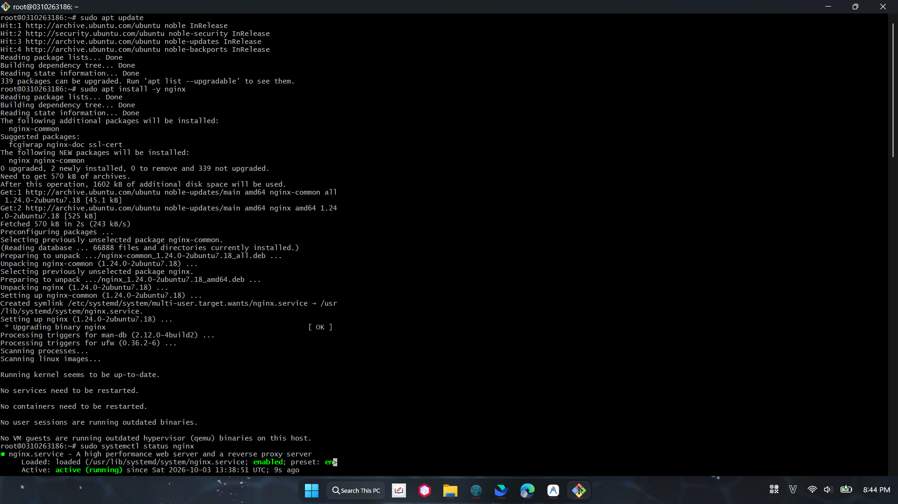
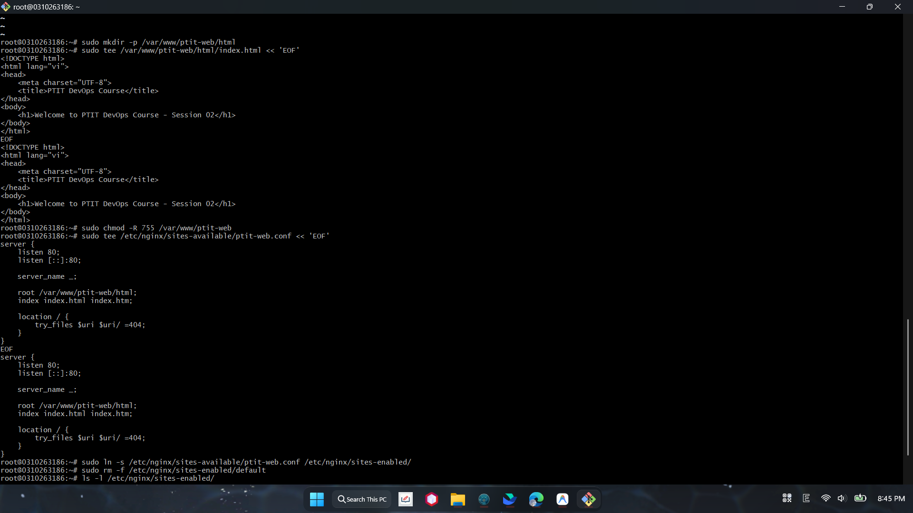
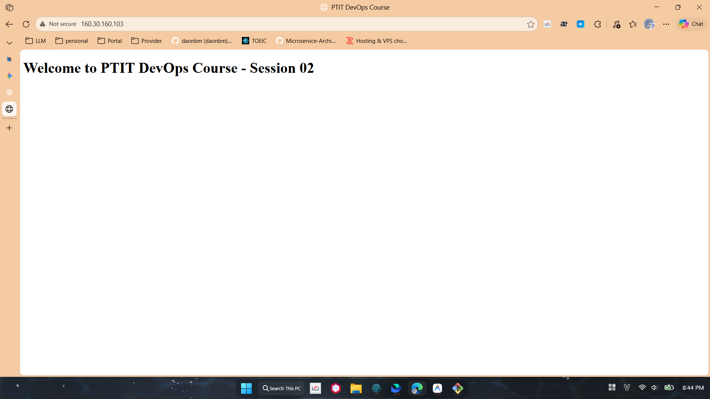

# BÀI TẬP 3: CÀI ĐẶT NGINX VÀ CẤU HÌNH WEBSITE TĨNH CƠ BẢN (BASIC NGINX WEB SERVER)

**Mã bài tập:** SESSION 02 - EXERCISE 3 (ss02-ex3)  
**Môn học:** IT215 - Cloud Infrastructure & DevOps Fundamentals  
**Máy chủ triển khai:** Ubuntu Server 24.04 LTS (`160.30.160.103`)  
**Web Server:** Nginx (Port 80)  

---

## 1. MỤC TIÊU

- Cài đặt dịch vụ Web Server Nginx trên Ubuntu Server thông qua trình quản lý gói `apt`.
- Tạo thư mục mã nguồn tĩnh tại `/var/www/ptit-web/html/` và tạo file `index.html` hiển thị dòng chữ: *"Welcome to PTIT DevOps Course - Session 02"*.
- Thiết lập Server Block tùy chỉnh `/etc/nginx/sites-available/ptit-web.conf` lắng nghe trên cổng 80, trỏ `root` về thư mục mã nguồn.
- Kích hoạt Server Block bằng symlink sang `/etc/nginx/sites-enabled/` và hủy kích hoạt cấu hình mặc định (`default`) để tránh xung đột cổng 80.
- Kiểm tra cú pháp Nginx và truy cập thành công website từ trình duyệt máy cá nhân qua địa chỉ IP máy chủ.

---

## 2. CÁC BƯỚC TRIỂN KHAI TRÊN MÁY CHỦ

### Bước 1: Cài đặt Nginx và kiểm tra trạng thái
Cập nhật danh sách gói và cài đặt Nginx:
```bash
sudo apt update
sudo apt install -y nginx
sudo systemctl status nginx
```

---

### Bước 2: Tạo thư mục mã nguồn và file `index.html`
Tạo thư mục lưu trữ mã nguồn web:
```bash
sudo mkdir -p /var/www/ptit-web/html
```

Tạo nội dung file `index.html`:
```bash
sudo tee /var/www/ptit-web/html/index.html << 'EOF'
<!DOCTYPE html>
<html lang="vi">
<head>
    <meta charset="UTF-8">
    <title>PTIT DevOps Course</title>
</head>
<body>
    <h1>Welcome to PTIT DevOps Course - Session 02</h1>
</body>
</html>
EOF
```

Phân quyền truy cập thư mục:
```bash
sudo chmod -R 755 /var/www/ptit-web
```

---

### Bước 3: Cấu hình Server Block `ptit-web.conf`
Tạo file cấu hình tại `/etc/nginx/sites-available/ptit-web.conf`:
```bash
sudo tee /etc/nginx/sites-available/ptit-web.conf << 'EOF'
server {
    listen 80;
    listen [::]:80;

    server_name _;

    root /var/www/ptit-web/html;
    index index.html index.htm;

    location / {
        try_files $uri $uri/ =404;
    }
}
EOF
```

---

### Bước 4: Kích hoạt Server Block & Hủy cấu hình mặc định
Tạo liên kết tượng trưng (symlink) sang `sites-enabled`:
```bash
sudo ln -s /etc/nginx/sites-available/ptit-web.conf /etc/nginx/sites-enabled/
```

Xóa cấu hình mặc định để giải phóng cổng 80:
```bash
sudo rm -f /etc/nginx/sites-enabled/default
```

Kiểm tra danh sách site đã kích hoạt:
```bash
ls -l /etc/nginx/sites-enabled/
```

---

### Bước 5: Kiểm tra cú pháp và nạp lại Nginx
```bash
sudo nginx -t
sudo systemctl reload nginx
```

---

## 3. HÌNH ẢNH MINH CHỨNG & LOG TERMINAL

### Minh chứng 1: Cài đặt Nginx và kiểm tra dịch vụ đang hoạt động



**Log thao tác:**
```text
root@0310263186:~# sudo apt update
Hit:1 http://archive.ubuntu.com/ubuntu noble InRelease
Hit:2 http://security.ubuntu.com/ubuntu noble-security InRelease
Hit:3 http://archive.ubuntu.com/ubuntu noble-updates InRelease
Hit:4 http://archive.ubuntu.com/ubuntu noble-backports InRelease
Reading package lists... Done
Building dependency tree... Done
Reading state information... Done
339 packages can be upgraded. Run 'apt list --upgradable' to see them.

root@0310263186:~# sudo apt install -y nginx
Reading package lists... Done
Building dependency tree... Done
Reading state information... Done
...
Setting up nginx (1.24.0-2ubuntu7.18) ...
 * Upgrading binary nginx                                                [ OK ]
Processing triggers for man-db (2.12.0-4build2) ...
Processing triggers for ufw (0.36.2-6) ...

root@0310263186:~# sudo systemctl status nginx
● nginx.service - A high performance web server and a reverse proxy server
     Loaded: loaded (/usr/lib/systemd/system/nginx.service; enabled; preset: enabled)
     Active: active (running) since Sat 2026-10-03 13:38:51 UTC; 9s ago
```

---

### Minh chứng 2: Tạo web tĩnh, cấu hình Server Block và kích hoạt site



**Log thao tác:**
```text
root@0310263186:~# sudo mkdir -p /var/www/ptit-web/html
root@0310263186:~# sudo tee /var/www/ptit-web/html/index.html << 'EOF'
<!DOCTYPE html>
<html lang="vi">
<head>
    <meta charset="UTF-8">
    <title>PTIT DevOps Course</title>
</head>
<body>
    <h1>Welcome to PTIT DevOps Course - Session 02</h1>
</body>
</html>
EOF

root@0310263186:~# sudo chmod -R 755 /var/www/ptit-web
root@0310263186:~# sudo tee /etc/nginx/sites-available/ptit-web.conf << 'EOF'
server {
    listen 80;
    listen [::]:80;

    server_name _;

    root /var/www/ptit-web/html;
    index index.html index.htm;

    location / {
        try_files $uri $uri/ =404;
    }
}
EOF

root@0310263186:~# sudo ln -s /etc/nginx/sites-available/ptit-web.conf /etc/nginx/sites-enabled/
root@0310263186:~# sudo rm -f /etc/nginx/sites-enabled/default
root@0310263186:~# ls -l /etc/nginx/sites-enabled/
lrwxrwxrwx 1 root root 41 Oct  3 13:42 ptit-web.conf -> /etc/nginx/sites-available/ptit-web.conf
```

---

### Minh chứng 3: Truy cập website từ trình duyệt máy cá nhân qua địa chỉ IP



- **Địa chỉ truy cập:** `http://160.30.160.103`
- **Tiêu đề trang:** `PTIT DevOps Course`
- **Nội dung hiển thị:** `Welcome to PTIT DevOps Course - Session 02`

---

## 4. DANH MỤC TỆP NỘP BÀI

- [index.html](./index.html): Mã nguồn trang HTML tĩnh.
- [ptit-web.conf](./ptit-web.conf): Cấu hình Nginx Server Block (port 80).
- [README.md](./README.md): Báo cáo chi tiết các bước triển khai kèm minh chứng thực tế.
